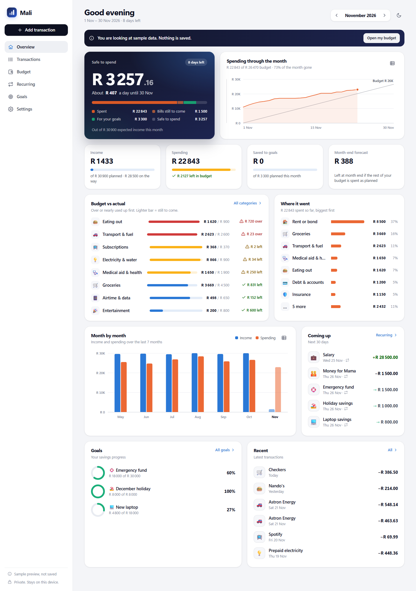
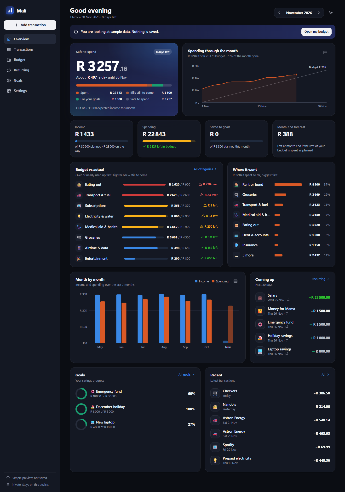
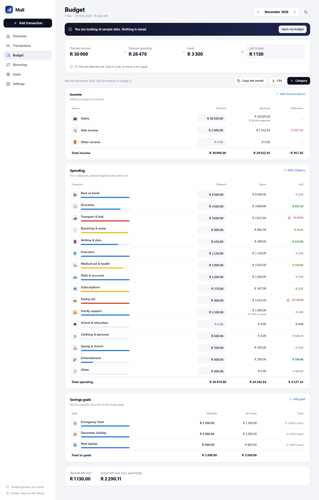
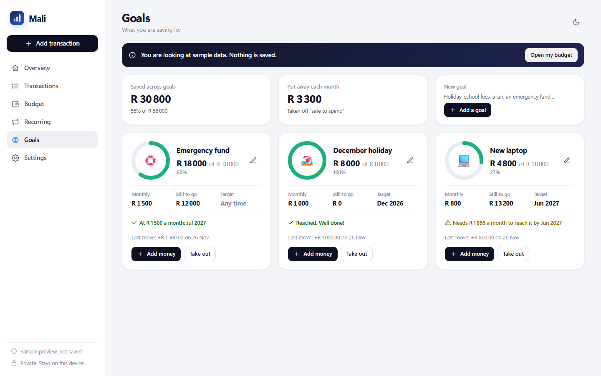
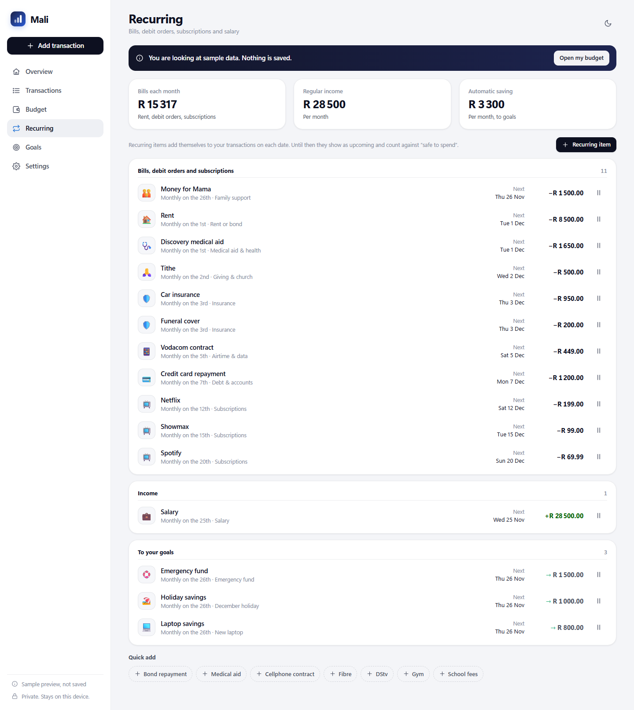
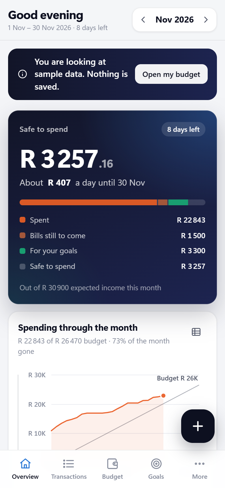
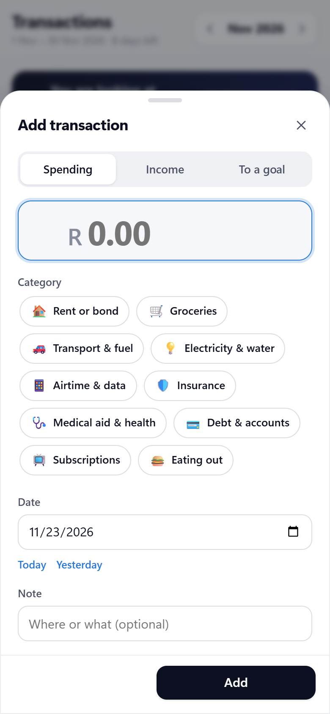

# Mali Budget

A private budget app in rand that replaces the Excel budget. Plan the month, track what comes in and goes out, and always know what is safe to spend.

- No account, no cloud, no tracking. Your data stays on this computer.
- Works offline, and installs as an app (PWA).
- Export to CSV (Google Sheets, LibreOffice, Excel) and to a full JSON backup.
- No packages to install. It needs only Node.js, which is already on this computer.



## Open it

**Double-click `Start Budget.cmd`** in this folder. Your browser opens at <http://localhost:4848>. Keep the small black window open while you use the app; close it when you are done.

Or, in a terminal in this folder:

```powershell
npm start
```

The first time, pick **Start my budget** (or **Look around with sample data** to explore first).

Tip: in Chrome or Edge, click the install icon at the right of the address bar to get Mali as its own app window. After the first visit it even opens when the black window is closed, because the app is saved for offline use.

## Where your data lives

| Copy | Where | Notes |
|---|---|---|
| Main copy | Your browser (local storage for `localhost:4848`) | Saved on every change |
| File copy | `data\budget.json` in this folder | Written while the app is running |
| Daily backups | `data\backups\budget-YYYY-MM-DD.json` | The last 30 days are kept |
| Your exports | Your Downloads folder | Settings › Export |

If the browser copy is ever cleared, the app restores itself from `data\budget.json`. Chrome and Edge on this computer share the same file copy. The `data` folder is excluded from git.

## What is in it

- **Overview**: safe to spend (with a per-day figure), spending through the month against an even budget pace, income, spending, goals, a month-end forecast, budget vs actual, where the money went, month by month, coming up, goals and recent transactions. Every chart has a table view (the grid icon).
- **Transactions**: quick add (press `N`), edit, delete with Undo, search across all months, filter by type and category.
- **Budget**: planned vs actual for income, spending and goals, with what is left to plan. Click any amount to change it; press Enter to jump to the next one. A month's plan carries forward to later months.
- **Recurring**: rent, debit orders, subscriptions, salary. They add themselves on each date and show as upcoming until then. Monthly, weekly, every 2 weeks or yearly.
- **Goals**: target, already saved, monthly amount, target month, progress ring and an estimate of when you will get there.
- **Settings**: export, import, theme (light, dark or automatic), how rand amounts look, and payday budgeting.

### How "safe to spend" works

Expected income this month (planned income, or what actually came in if that is more)
minus what you have already spent
minus bills still to come this month (recurring items and anything dated later)
minus what you are putting into goals this month.

The **month-end forecast** tile is stricter: it assumes the rest of every category budget gets spent as planned.

### Payday to payday

Settings › Budget month starts › pick your payday. With a payday on the 25th, "December" runs from 25 November to 24 December.

## Bringing in the old Excel budget

1. Open the `.xlsx` in Google Sheets or LibreOffice (Excel itself is not needed).
2. Save or download the transactions sheet as **CSV**.
3. In Mali: Settings › Import › Transactions from CSV.

The file needs a **Date** and an **Amount** column (or **Debit** and **Credit**). **Category**, **Note** (or Description) and **Type** (Expense, Income, Savings) are used when present. Dates like `23/11/2026`, `2026-11-23` and `23 Nov 2026` all work, and so do amounts like `R 1 234,56` or `-1234.56`. New categories are created as needed and rows that are already in Mali are skipped, so importing the same file twice is safe. Bank statement CSVs work too: negative amounts become spending, positive amounts become income.

## On your phone

The app is also online at **<https://justngobs.github.io/mali-budget/>** (free GitHub Pages hosting, https).

1. Open that address on your phone.
2. Android (Chrome): tap **Install app** when offered, or ⋮ › **Add to Home screen**. iPhone (Safari): Share › **Add to Home Screen**.
3. Open Mali from the home screen icon. It works offline after the first visit.

Only the app's files are on GitHub. Your budget data stays on the phone, in that browser; nothing is sent to the website. Phone and computer do not sync: move data between them with Settings › Export › Full backup and Import › Restore a backup. Install it to the home screen and take a full backup now and then, because a phone browser can clear website data for sites you have not installed.

**Updates:** every push to `main` runs the tests and republishes the `app/` folder (see `.github/workflows/pages.yml`). The installed app picks up the new version the next time it opens online.

## Keyboard

| Key | Does |
|---|---|
| `N` | Add a transaction |
| `Ctrl` + `Enter` | Save and add another |
| `←` `→` | Previous or next month |
| `/` | Search transactions |
| `Esc` | Close a form |

## For developers

- Plain HTML, CSS and JavaScript modules in `app/`, no build step. Charts are hand-drawn SVG.
- `serve.mjs`: a small static server that also reads and writes `data/budget.json`. It listens on 127.0.0.1 and ::1 only and refuses other host names and cross-site writes.
- Tests: `npm test` (budget maths, payday months, recurring items, CSV round trip).
- Screenshots: start the server, then `node tools/screenshots.mjs` (uses headless Chrome; it also checks offline mode).
- Icons: `python tools/make_icons.py`.
- Use another port with `set PORT=4849` before starting. Note that browser data belongs to one address, so keep using the same port.

## Screenshots

| | |
|---|---|
|  |  |
|  |  |
|  |  |
